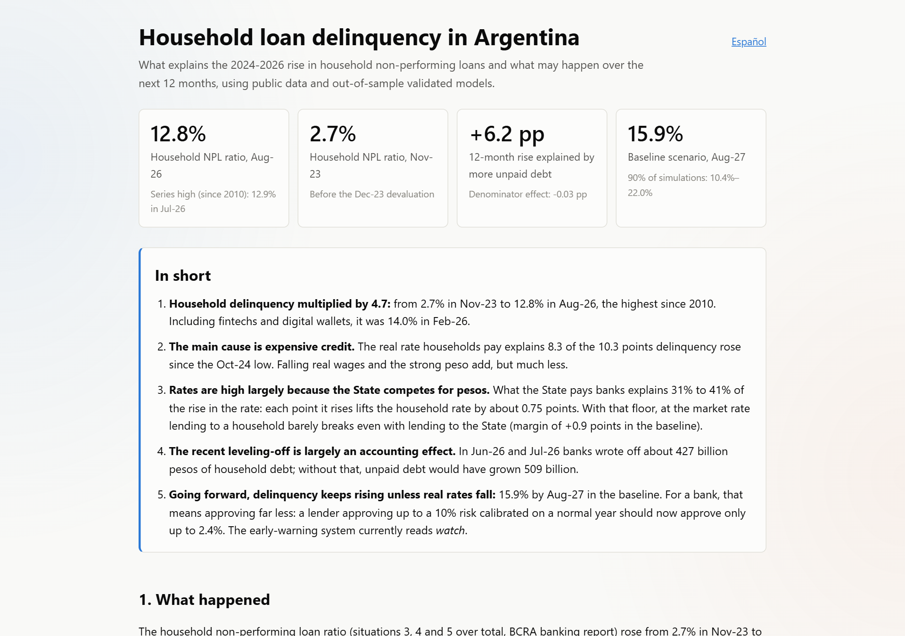

# Household loan delinquency in Argentina

[](https://github.com/alvarez1lucas/mora_argentina/actions/workflows/tests.yml) [](https://github.com/alvarez1lucas/mora_argentina/actions/workflows/actualizar-datos.yml) [](https://github.com/alvarez1lucas/mora_argentina/actions/workflows/publicar-sitio.yml) 

**[Live site](https://alvarez1lucas.github.io/mora_argentina/)** · **[2-page report (PDF)](https://alvarez1lucas.github.io/mora_argentina/informe-en.pdf)** · [Versión en español](README_ES.md)

[](https://alvarez1lucas.github.io/mora_argentina/en/)

## At a glance

- **Question.** Why household delinquency in Argentina multiplied by 4.7 since Nov-23, and where it goes next.
- **Answer.** Expensive credit. The real loan rate explains +8.3 pp of the rise from 2.5% to 12.8%, and 30–31–39–41% of the rate's rise comes from what the State pays banks. Baseline for Aug-27: 15.9%.
- **What it shows.** An end-to-end pipeline on public data only, time-series econometrics validated out of sample, causal ML on a 66-bank panel, an early-warning index and a decision layer for lenders (approval cutoffs, minimum rate). Data refresh weekly; the site, the report and this README are regenerated from `outputs/` by GitHub Actions, with the test suite running in CI.
- **Stack.** Python (pandas, statsmodels, scikit-learn, LightGBM, EconML, SHAP), Plotly, pytest, GitHub Actions, GitHub Pages.

What explains the 2024-2026 surge in household non-performing loans in Argentina, and what may happen over the next 12 months? This project answers with public data only (BCRA, INDEC, Buenos Aires City statistics, A3 Mercados), time-series and panel econometrics, causal ML, and out-of-sample validation. Every number below is generated from `outputs/` by `python -m mora.informe`; the pipeline refreshes weekly via GitHub Actions.

## Key results (data as of Aug-26)

- **Delinquency multiplied by 4.7.** The household NPL ratio (BCRA situations 3-5) rose from 2.7% in Nov-23 to 12.8% in Aug-26, the highest since the series starts in 2010 (peak 12.9% in Jul-26). Personal loans: 17.0%; credit cards: 12.2%.
- **It is unpaid debt, not a shrinking portfolio.** Of the 12-month rise, +6.2 pp is the numerator (real growth in non-performing debt) and -0.03 pp the denominator.
- **Early warning.** A signals-approach index (Kaminsky-Reinhart) built on early arrears (31-90 days), the payment burden, real rates, credit growth, activity and tax revenue reads **watch** as of Sep-26. Trained only on data up to 2023, it was at watch level or higher in 76% of the months that preceded the 2025 surge, but it switched off from Aug-24 to Nov-24, right before it. Tax revenue arrives early but barely anticipates delinquency.
- **Beyond banks.** Non-bank credit providers (fintechs, digital wallets, non-bank card issuers) hold 18% of household credit, with a 26.9% non-performing ratio in Feb-26 (BCRA semiannual reports); combined, household delinquency was 14.0% rather than the banks' 11.2%. On the funding side, mutual funds held national debt worth 2.0% of GDP in Jun-26 (peak 2.8% in Dec-23, CAFCI), taking exposure to the State from 9.8% (banks) to 11.7% of GDP. Money market funds, where wallets park user balances, hold only 1.4% in government paper: their money reaches the State through banks, so it is not added twice.
- **Two-stage chain: sterilization raises the rate, the rate raises delinquency.** Sterilization and the loan rate are not competing channels, so they are weighted in sequence. *Stage 1:* the real all-in cost (CFT) of personal loans rose 35–36 pp (from 25–26% to 61–62% in the months that drive the window); what the State pays banks on peso securities and repos (from their income statements, restated for inflation) explains 30–31–39–41% of that rise: each point it rises lifts loan rates by 0.75 points (nominal rates, p < 0.001). In 2025 it averaged 46.4%, above BADLAR (41.7%), and it beat BADLAR in 85% of months since Nov-23. *Stage 2:* in a counterfactual historical decomposition of the rise from Oct-24 (2.5%) to Aug-26 (12.8%), the real rate is the dominant channel, +8.3 pp (p = 0.007–0.026): +2.6–2.8 to +3.5–3.7 pp from what the State pays (with the estimated pass-through and in the accounting split), the rest from the bank premium and +1.5 pp from VAT. With a separate coefficient for what the State pays, its contribution is +5.0–5.6 pp (p = 0.021–0.023).
- **Purchasing power matters more under realistic price measures.** The real registered wage is 7.9% below Nov-23 with the official CPI, 9.4% with the mix and 11.0% with an updated-weights basket. Its contribution goes from +0.7 pp (p = 0.148) to +2.1 pp (p = 0.009).
- **The recent leveling-off is largely write-offs.** In Jun-26 and Jul-26 household non-performing debt grew 59 / 22 billion constant pesos while about 238 / 189 billion were written off; without write-offs it would have grown 298 / 211 billion. For the total private sector, the Jul-26 ratio would be 9.4% instead of 7.7%.
- **Vintage (cosecha) effect at bank level.** Across 66 banks with entity and month fixed effects, 10 pp more real consumer-credit growth 12-24 months earlier adds 0.35 pp to the annual change in NPLs (p < 0.001); Double ML: 0.14 pp (p = 0.049); causal forest ATE: 0.20 pp (95% CI 0.03 to 0.37).

### Scenarios to Aug-27 (household NPL ratio, currently 12.8%)

| Price measure | Sample | Baseline | 90% band | Adverse | Favorable | IFRS 9 weighted |
|---|---|---|---|---|---|---|
| Official (INDEC) | 2010+ | 15.9% | 10.4–22.0% | 19.7% | 13.3% | 16.5% |
| Mix | 2010+ | 15.7% | 10.0–22.1% | 19.2% | 13.3% | 16.3% |
| Selected (updated basket) | 2017+ | 13.9% | 7.4–20.5% | 16.2% | 12.2% | 14.2% |

The satellite model beats the AR(1) and the random walk out of sample (12-month RMSE 2.25 pp vs 2.92 and 3.12). IFRS 9 weights: 60% baseline, 25% adverse, 15% favorable. **In the baseline, delinquency keeps rising** because the real loan rate stays near historical highs; it only falls if real rates fall.

## What a lender would do with this

- **Tighten approval, and by how much.** A scoring model calibrated on a normal year underestimates today's personal-loan risk about 4 times. To run the same risk, a lender approving up to a 10% probability of default (PD) should approve only up to 2.4%.
- **Price against the State, not against the deposit rate.** At the market rate, lending to a household instead of to the State (38.0% a year) leaves a margin of +0.9 points in the baseline and -8.6 in the adverse scenario; the business breaks even at a 21.3% PD.
- **Applied to a real scoring model.** On the predictions of a [validated PD model](https://github.com/alvarez1lucas/homecredit-pd-validation), counting the opportunity cost of not lending to the State, approval goes from 93% in a normal year to 52% in the baseline.
- **Provision and monitor.** IFRS 9-weighted delinquency for Aug-27 is 16.5% (today 12.8%); the early-warning index reads **watch** and is recomputed every week.

## Approach

| Phase | What | Module | Output |
|---|---|---|---|
| 1-2 | Data survey and reproducible ingestion (BCRA APIs and files, INDEC, datos.gob.ar, A3) | `mora.ingest` | `data/processed/` |
| 3 | Descriptive: lines, bank groups, numerator vs denominator, write-off-adjusted ratio | `mora.descriptivo` | `outputs/descriptivo/` |
| 4 | Satellite model with out-of-sample validation, long (2010+) and clean (2017+) samples | `mora.satelite` | `outputs/modelo/` |
| 4b | Three price measures: official, updated-weights basket, mix | `mora.deflactores`, `mora.robustez` | `outputs/robustez/` |
| 5 | Channel weighting, mediation, opportunity cost, bank panel, causal ML, early warning | `mora.canales`, `mora.rendimientos`, `mora.panel`, `mora.panel_ml`, `mora.ajuste` | `outputs/canales/`, ... |
| 6 | Scenarios with simulation bands and IFRS 9 weighting | `mora.escenarios` | `outputs/escenarios/` |
| 7-8 | Website, report and this README, generated from outputs | `mora.sitio`, `mora.informe` | `site/`, `README*.md` |

## Methods

- Target: logit of the NPL ratio; unit-root tests (ADF, KPSS, Zivot-Andrews) → the model is in differences (no spurious levels regression).
- Lags chosen by BIC inside economically bounded grids, with expected-sign restrictions; HAC standard errors.
- COVID-era classification relief (BCRA A6938/A7245) and its unwinding are excluded from estimation.
- Expanding-window out-of-sample evaluation with re-selection at each origin, against a random walk and an AR(1).
- Counterfactual historical decomposition with coefficient-CI bands; mediation by splitting the loan rate.
- Bank panel: two-way fixed effects (clustered), event study around the Jul-25 tightening, Double ML and causal forest (EconML), LightGBM + SHAP early warning (linear: RMSE 7.97, top-decile precision 30%; LightGBM: 8.28, 46%).
- Granger tests, where used, are descriptive only.

## Limitations

- Data are aggregates: individual borrowers are not observed. The credit bureau (Central de Deudores) is not used, for privacy reasons.
- Delinquency in the informal sector and on non-bank platforms (Mercado Pago, Ualá) is not in these data; their rates do appear in the transparency survey.
- Estimated relationships are not strictly causal. Lagged regressors mitigate but do not remove reverse causality (e.g., spreads also rise because delinquency rises).
- There is a single adjustment cycle of this kind and the clean sample has 77 months: bands are wide and always reported.
- Household write-offs and GDP for the latest quarters are estimates (flagged in the data).
- The selected price measure is our own proposal: it changes the index weights (ENGHo 2017/18), not INDEC's price collection.
- There are no recent public series for bounced checks, tax-agency (ARCA) garnishments or the stock of refinanced loans.
- The channel model explains but does not forecast: its 12-month RMSE (3.80 pp) is worse than an AR(1) (3.43).
- With the updated-weights basket, no long-sample specification has the expected signs (its 2010-2016 inflation makes real rates deeply negative), so that scenario uses the 2017+ sample. The long model depends on how inflation during the statistical blackout is measured.

## Reproduce

```bash
pip install -r requirements.txt && pip install -e .
python -m mora.ingest          # downloads and processes public data (bank files: ~2.7 GB, kept out of git)
python -m mora.descriptivo && python -m mora.satelite && python -m mora.robustez
python -m mora.panel && python -m mora.panel_ml && python -m mora.rendimientos && python -m mora.canales
python -m mora.ajuste && python -m mora.escenarios
python -m mora.sitio && python -m mora.informe
pytest
```

Configuration lives in `config/` (`settings.yaml`, regimes, monetary events). Methodological notes: `docs/`.

## Data

BCRA (banking report annex, financial institutions monthly files, statistics API v4, transparency regime), INDEC (CPI by division, wages, employment, EMAE, GDP), Buenos Aires City statistics (IPCBA), datos.gob.ar, A3 Mercados (dollar futures). The credit bureau (Central de Deudores) is deliberately not used, for privacy.

Author: Lucas Alvarez · [GitHub](https://github.com/alvarez1lucas) · Related: [Credit thresholds](https://github.com/alvarez1lucas/umbrales-credito), [Credit risk models](https://github.com/alvarez1lucas/modelos-credito) ([interactive app](https://alvarez1lucas.github.io/modelos-credito/app/))
